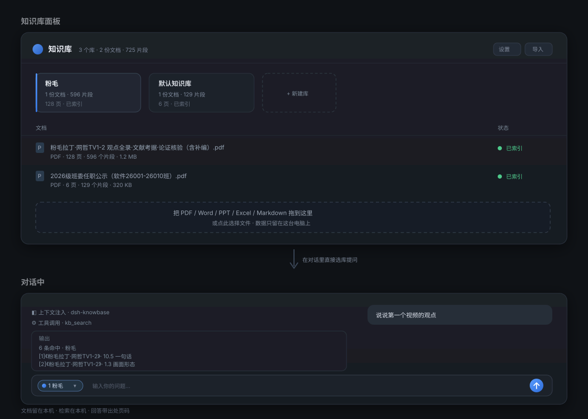

# dsh-knowbase

> 为 [DeepSeek Harness](https://github.com/deepseek-ai/deepseek-harness)（简称 DSH）打造的**本地知识库**插件。
>
> 把你自己的 PDF、Word、PPT、Excel 拖进来，它自动建索引；提问时先从你的库里检索，再把**原文片段 + 出处页码**交给模型回答。所有数据留在你自己电脑上。

<p align="center">
  <em>文档还在你手里 · 检索全在本机 · 答案有据可查</em>
</p>

<p align="center">
  
</p>

---

> ## ✅ 当前状态：v0.6.8 已发布
>
> 可以直接安装使用。下面描述的功能均已实现并通过 **68 项自测**。
>
> **安装方式**见下方[安装](#安装)一节；下载见 [Releases](https://github.com/EXhypr-hub/dsh-know/releases/latest)。
> 访问 github.com 困难时，看[下载加速](#下载加速)。
>
> 已知限制、安全说明与版本支持范围分别见
> [安全说明](dsh-knowbase/docs/SECURITY.md) 与 [版本适配](dsh-knowbase/docs/COMPAT.md)。

---

## 目录

- [它解决什么问题](#它解决什么问题)
- [功能一览](#功能一览)
- [系统要求](#系统要求)
- [安装](#安装)
- [下载加速](#下载加速)
- [在对话里直接用知识库](#在对话里直接用知识库)
- [快速上手](#快速上手)
- [模型接入](#模型接入)
- [联网抓取](#联网抓取)
- [数据存在哪](#数据存在哪)
- [隐私说明](#隐私说明)
- [常见问题](#常见问题)
- [故障排查](#故障排查)
- [开发状态](#开发状态)
- [反馈与参与](#反馈与参与)
- [许可证](#许可证)

---

## 它解决什么问题

### 资料堆在硬盘里，找不到

几百篇 PDF、标书、表格散在文件夹里。想看「某个概念在哪本书第几页」，只能靠文件名猜。

**做法**：拖进来 → 自动切块并建立语义索引 → 用大白话提问，返回原文片段和页码。

### AI 说得头头是道，但不知道真假

通用模型靠记忆回答，会编。

**做法**：回答前强制检索你的库，答案必须带「来自《书名》P.123」；库里没有就明说没有。

### 想建专题库，但不知道去哪找正规资料

网上转手的 PDF 错漏多、来路不明。

**做法**：内置权威来源清单（国家科技图书文献中心、国家统计局、国家标准全文公开系统、求是网、NCBI PMC、arXiv、OpenStax 等），并给模型一套「建库方法」。

---

## 功能一览

| 功能 | 说明 | 状态 |
|---|---|---|
| 拖拽导入 | 支持 PDF / DOCX / PPTX / XLSX / Markdown / TXT / HTML | ✅ 已实现 |
| 自动切块 | 按标题层级 → 段落 → 定长重叠，中文友好；可展开看实际切块 | ✅ 已实现 |
| 关键词检索 | FTS5 全文索引，中文可用 | ✅ 已实现 |
| 语义检索 | 向量 + 关键词混合检索（RRF 融合） | ✅ 已实现 |
| 重排 | 粗搜后二次精排：本地 ONNX 或 API，可关 | ✅ 已实现 |
| OCR | 扫描件识别：接视觉 API，或本地 tesseract（可下载语言包），可关 | ✅ 已实现 |
| 引用溯源 | 每条结果带文档名、页码 | ✅ 已实现 |
| 模型自选 | 嵌入 / 重排独立选择：13 家服务商 47 个模型 / 本地模型 | ✅ 已实现 |
| 本地模型 | 一键下载模型与推理依赖，完全离线 | ✅ 已实现 |
| 设备自测 | 点一下测出你这台机器 CPU 和 GPU 哪个快，给出建议 | ✅ 已实现 |
| 智能体工具 | 五个工具：检索 / 导入 / 抓取 / 建库 / 查任务 | ✅ 已实现 |
| 内置技能 | `knowledge-base` 教模型何时查库、如何建库 | ✅ 已实现 |
| 权威来源采集 | 14 条权威来源清单 + 抓取总开关 + 通用防护 | ✅ 已实现 |
| 数据可迁移 | 备份、换盘（**自动探测本机所有磁盘**）、清空 | ✅ 已实现 |
| 对话选库 | 输入 @ 选知识库，提问时自动检索并注入资料 | ✅ 已实现 |
| 下载加速 | 内置脚本自动挑可用加速站，绕过 github.com 抽风 | ✅ 已实现 |

---

## 系统要求

| 项 | 要求 |
|---|---|
| DSH | **0.1.7-rc.2 及以上**（详见 [版本适配](dsh-knowbase/docs/COMPAT.md)） |
| 操作系统 | Windows 10+ / macOS 12+ / 主流 Linux |
| 内存 | 建议 8GB 以上 |
| 磁盘 | 每 100 份 PDF 约 0.5GB；本地模型另需约 600MB |
| 显卡 | **不需要**。本地模型走 CPU 即可；另提供 GPU 选项可自行实测 |

### 关于版本支持

本插件声明 `engines.dsh: ">=0.1.7-rc.2 || >=0.2.0-rc.2 || >=0.2.1-rc.1 || >=0.2.2-rc.1"`。
这个结论来自逐条比对 DSH 自带的
`docs/upgrade-guide/`——从 v0.1.7-rc.2 到 v0.2.2-rc.1 的 213 条破坏性变更中，
没有一条涉及本插件用到的 slots / connection.fetch / tools / skills / locale。

运行时也不靠版本号判断：插件会探测 API 在不在，缺什么就降级什么，
而不是直接崩溃。具体降级行为见 [版本适配](dsh-knowbase/docs/COMPAT.md)。

### 关于体积

**两种产物，体积差很多：**

| 产物 | 体积 | 用途 |
|---|---|---|
| 源码包（npm pack） | **约 140 KB** / 30 文件 | 从 GitHub 安装或本地源码安装，依赖由包管理器拉取 |
| 离线包（Releases 里的 zip） | **约 157 MB** | 完全断网的机器，解压即用，含全部依赖 |

从源码安装后，本地 `node_modules` 约 **565 MB**，构成如下：

| 内容 | 体积 | 说明 |
|---|---|---|
| onnxruntime-node | 288 MB | 本地推理运行时，含 Windows/macOS/Linux 三平台 |
| onnxruntime-web | 141 MB | 浏览器专用，Node 不会加载 |
| tesseract.js-core | 44 MB | 本地 OCR 的 wasm |
| @napi-rs/canvas | 38 MB | PDF 渲染成图片（OCR 用） |
| pdfjs-dist | 17 MB | PDF 文字抽取 |
| @huggingface + 其它 | 约 37 MB | 模型加载器与工具库 |

**如果空间紧张**，可以跑一次可选瘦身（只删 Node 永远用不到的浏览器专用文件，
不删任何跨平台二进制）：

```bash
cd dsh-knowbase
npm run slim:check   # 先看能省多少（约 157MB）
npm run slim         # 执行，自动备份 + 验证，失败自动还原
npm run slim:restore # 想还原时
```

> **纯 API 方案**可以完全不占本地算力，也不下载模型。

---

## 安装

### 方式一：从 GitHub 安装（推荐）

1. DSH → 左侧「插件」
2. 点「添加插件」
3. 填入本仓库地址：
   ```
   https://github.com/EXhypr-hub/dsh-know
   ```
4. 等待依赖安装完成（首次约需下载 565MB，见上方体积说明）

### 方式二：离线包（完全断网可用）

适合不方便联网装依赖的机器。

1. 到 [Releases](https://github.com/EXhypr-hub/dsh-know/releases/latest) 下载 `dsh-knowbase-offline.zip`（约 157MB）
2. 解压到任意位置，得到一个 `dsh-knowbase` 文件夹
3. DSH → 左侧「插件」→「添加插件」→ 选择这个 `dsh-knowbase` 文件夹

离线包已经内置全部依赖，**不需要联网装依赖**，解压即用。

> 如果下载慢或打不开，看下面的[下载加速](#下载加速)。

### 方式三：从本地目录安装（开发用）

1. 下载本仓库源码，解压到任意位置
2. 进入 `dsh-knowbase` 目录跑一次 `npm install`
3. DSH → 左侧「插件」→「添加插件」→ 选择 `dsh-knowbase` 文件夹

---

## 下载加速

国内访问 `github.com` 经常超时（但 `api.github.com`、`raw.githubusercontent.com`、
`objects.githubusercontent.com` 通常都是通的，卡住的往往只有 `github.com` 这一个门）。

### 办法一：用脚本自动下载（推荐）

脚本会依次测几个加速器，挑第一个能用的去下，并显示进度与速度：

```bash
cd dsh-knowbase
node scripts/download-release.mjs                    # 看看有哪些文件
node scripts/download-release.mjs dsh-knowbase.tgz   # 下指定文件
node scripts/download-release.mjs --all              # 全部下载
node scripts/download-release.mjs --check            # 只测加速器连通性
```

### 办法二：手动拼加速前缀

在原始链接前面加一个加速站前缀即可：

| 加速站 | 用法 |
|---|---|
| `gh-proxy.com` | `https://gh-proxy.com/` + 原始链接 |
| `ghfile.geekertao.top` | `https://ghfile.geekertao.top/` + 原始链接 |

例如离线包的原始链接是：

```
https://github.com/EXhypr-hub/dsh-know/releases/download/v0.6.1/dsh-knowbase-offline.zip
```

用加速器下载就变成：

```
https://gh-proxy.com/https://github.com/EXhypr-hub/dsh-know/releases/download/v0.6.1/dsh-knowbase-offline.zip
```

> 实测速度约 **1.95 MB/s**，157MB 的离线包约 80 秒下完。
> 加速站是第三方服务，可用性会变；一个不行就换另一个，或直接跑上面的脚本让它自己挑。

### 办法三：git 操作加速

如果 `git clone` / `git push` 也卡，SSH 走 443 端口通常比 22 端口稳：

```bash
# ~/.ssh/config
Host github.com
  HostName ssh.github.com
  Port 443
  User git
```

---

### 安装后

- **重启一次 DSH**（插件后端代码需要加载）
- 左侧栏会出现知识库图标

> **依赖说明**：从 GitHub 或本地源码安装时，由包管理器自动拉取依赖（约 565MB）。
> 用离线包安装则依赖已内置，**完全不需要联网**。

---

## 在对话里直接用知识库

除了让模型自己检索，你也可以在输入框里**直接指定用哪个库**：

1. 在输入框打 `@`
2. 菜单里出现「知识库」分组，选中你要的库
3. 草稿里会出现 `@kb:产品文档` 这样的标记
4. 正常提问、发送

发送之后自动完成三步：

| 步骤 | 做什么 |
|---|---|
| ① 问题向量化 | 用你配的嵌入模型把问题转成向量 |
| ② 相似度检索 | 在该库里算相似度，取出最相关的若干片段 |
| ③ 增强提示 | 把片段连同「仅依据资料回答、标注出处」的要求一起交给模型 |

**不选知识库时行为不变** —— 模型仍会在需要时自己调检索工具。所以这是可选增强，不是必经步骤。

一条消息可以带多个库（`@kb:产品文档 @kb:技术手册`），会分别检索后合并。

如果库被删了、没建索引、或没配嵌入模型，**消息照常发出**，只是附一句说明告诉模型这次没取到资料。

> 旧版 DSH 没有输入框菜单服务时，这个入口自动隐藏，其余功能不受影响。

---

## 快速上手

1. 左侧栏点**知识库**图标
2. 点「新建库」，起个名字，比如 `自然科学`
3. 把 PDF 拖进虚线框，等进度条走完
4. 在「检索测试」里输入问题，例如：`光合作用的能量转换过程`
5. 看到若干卡片，每张带书名、页码、相似度
6. 回到对话里问：`根据我的自然科学库，解释光合作用的两个阶段`

模型会先检索，再带着引用回答。

---

## 模型接入

**没有默认值，首次使用会让你自己选。** 三类能力互相独立，可以全部本地、全部 API，或者混搭。

### 嵌入（把文字变成向量）

| 方式 | 适合 |
|---|---|
| 本地模型（Qwen3-Embedding-0.6B 等） | 看重隐私、库不大 |
| OpenAI 兼容 API（`/v1/embeddings`） | 库很大、想省时间 |
| 自定义服务地址 | 有内网服务 |

### 重排（从候选里挑最相关的几条）

本地 ONNX / 兼容 API / **关闭**（库小时可关）

### OCR（识别扫描件）

视觉模型 API / 专用 OCR API / 本地 OCR / **不用**

### 参数都能调

选中方案后，所有可调项都会列出来，每项都有说明和推荐值：

- 本地嵌入：模型、量化精度、线程数、批大小
- API 嵌入：地址、模型名、维度、超时、重试、并发
- 重排：模型、top_n、分数阈值
- OCR：地址、模型名、图片边长、语言、并发

**每个参数旁边有「测试一下」按钮**，点一下立刻知道通没通、耗时多少，不用猜哪里填错。

### 三条硬规则

1. **API Key 只存进 DSH 凭据库**，不写入任何配置文件；界面上只显示「已配置 / 未配置」。
2. **换嵌入模型后必须重建索引**。不同模型的向量不能混用，插件检测到不一致会禁止检索并提示重建，而不是给出错误结果。
3. **模型下载走镜像**：`hf-mirror.com` 或 `modelscope.cn`，也可直接填本地已有的模型目录。

---

## 联网抓取

插件里有一个**总开关**，初始为**关闭**（关着完全不联网）。

| 状态 | 行为 |
|---|---|
| 关闭 | 完全不联网，只用你拖进来的文件 |
| 开启 | 可按内置清单取资料，也可访问清单外的站点 |

开启后的通用防护：

- 只走 `http` / `https`
- **拒绝内网地址**（`127.0.0.1`、`10.x`、`192.168.x` 等），防止被诱导探测局域网
- 遵守 `robots.txt`；同站点串行，间隔 ≥ 2 秒
- 单文件 ≤ 100MB，单次任务 ≤ 200 个文件
- 每份文档记录来源 URL、抓取时间、站点声明的许可
- 遇到登录、付费、验证码**停下给出链接**，不做绕过
- 随时可中断

> 想要更严，可在设置里开启「仅允许以下站点」，变成白名单模式。

---

## 数据存在哪

默认目录（首次启动会询问，可改）：

```
Windows:  <你选的盘>:\dsh-knowbase\
macOS/Linux: ~/.dsh/knowbase/
```

**换位置时会自动探测本机所有磁盘**，列出每个盘的总容量和剩余空间，
点一下就能把数据搬过去。不想用某个盘也可以手动填路径。

```
dsh-knowbase/
├── kb.sqlite        ← 索引：库、文档、卡片、向量
├── files/           ← 原始文件副本
├── models/          ← 本地模型
├── secrets.json     ← 嵌入 API Key（若授权了凭据库则存在系统凭据里）
├── ocr-secrets.json ← OCR Key（同上，凭据库优先）
└── exports/         ← 导出的引用清单
```

### 备份

关掉 DSH，复制整个 `dsh-knowbase` 文件夹即可。

### 换位置

设置里填新路径，插件会迁移并**校验哈希**，确认无误才删旧数据。

### 清空

设置里有「删除整个知识库」，二次确认后连文件带索引一起删，**不可恢复**。

---

## 隐私说明

| 情况 | 数据出不出本机 |
|---|---|
| 拖入文件、切块、建索引（本地模型） | ❌ 不出 |
| 检索你的库 | ❌ 不出 |
| 用 API 嵌入 | ✅ 文本片段发往该 API |
| 用 API 重排 | ✅ 问题和候选片段发往该 API |
| 用 API OCR | ✅ 扫描页图片发往该 API |
| 联网抓取 | ➖ 只发出对目标站点的请求，不发库内容 |

**还有两点必须讲明：**

1. 命中的库片段会进入对话上下文，**因此也会随这次对话发给当前对话模型**。这是「让模型带着资料回答」的必要代价。
2. 库内容会作为工具结果写入 DSH 会话日志（本机）。要彻底不留痕，需删除对应会话。

---

## 常见问题

### 扫描版 PDF 识别不出文字？

这类 PDF 只有图片、没有文字层，需要开 OCR。

处理方式：插件会自动识别并标记为「需 OCR」。开启 OCR 后，
在文档行点「重新解析」即可补识别；重新导入同一文件也会自动重试，不会被当成重复文件跳过。

### Excel / PPT 里的内容有缺失？

合并单元格、图表里的说明文字、SmartArt 中的文字会丢失。

插件只保证「正文可读、按行/页成段」，不保证版式还原。

### 中文切块会不会切碎？

不会。中文没有空格，所以不按词切，而是按**标题层级 → 段落 → 定长重叠**。

### 换了嵌入模型，检索结果变差？

不同模型的向量不能混用。换模型后必须重建索引，插件会强制提示。

### 下模型总是失败？

`huggingface.co` 在国内不稳定。请使用：

- `hf-mirror.com`
- `modelscope.cn`
- 或直接指定本地已有模型目录

### 库能放多大？

暴力向量检索在 10 万卡片以内表现良好，约相当于数千份文档。超过后检索会变慢。

### 卸载会删我的资料吗？

不会。卸载插件不删除知识库，数据仍在数据目录里。要删请在设置里操作。

---

## 故障排查

| 现象 | 处理 |
|---|---|
| 装了没反应 | 重启 DSH |
| 改了界面没变化 | 前端代码有缓存，按 `Ctrl + Shift + R` 硬刷新 |
| 左侧没有图标 | 检查插件是否已启用 |
| 检索不出结果 | 确认文档状态为「已入库」；换过嵌入模型则需重建索引 |
| API 配置后不生效 | 在设置里点「测试一下」看具体错误 |
| 上传卡住 | 大文件较慢；检查磁盘剩余空间 |
| 提示需要重建索引 | 换过嵌入模型，属正常提示 |
| 点「展开看切块」没反应 | 硬刷新后再试（`Ctrl + Shift + R`） |
| 测速按钮报「需先设为本地模型」 | 已修为直接用界面上当前的选择，不受是否保存影响 |
| 测速很久没动静 | 首次测速要加载模型，十秒以上正常；按钮会显示「测速中…」 |
| 下载 Release 卡住或打不开 | 用[下载加速](#下载加速)，或跑 `node scripts/download-release.mjs` |
| 说「GPU 测不通」 | 正常，很多机器上 DirectML 不可用或更慢；保持 CPU 即可 |

---

## 开发状态

项目按阶段推进，六个阶段均已完成。

| 阶段 | 内容 | 状态 |
|---|---|---|
| P0 | 插件骨架：打包、图标、中英双语、界面框架 | ✅ 已完成 |
| P1 | 导入与存储：拖拽、格式解析、切块、数据库 | ✅ 已完成 |
| P2 | 检索：关键词 + 向量 + 融合 + 智能体工具 | ✅ 已完成 |
| P3 | 模型接入：本地模型、重排、OCR、参数面板 | ✅ 已完成 |
| P4 | 权威来源采集：来源清单、抓取开关、许可记录 | ✅ 已完成 |
| P5 | 打磨：切块修复、i18n、界面重构、详情页配图 | ✅ 已完成 |
| P6 | 收尾：安全加固、磁盘探测、版本适配、发布 | ✅ 已完成 |

### 版本历史

| 版本 | 主要变化 |
|---|---|
| **v0.6.8** | 全量安全与正确性审计：修 SSRF 的 DNS/重定向绕过、OCR Key 明文落库、跨库共享文件误删、模型下载必崩、失败文档无法重试；多选库不再退化为全库检索；预检索白跑与回合摘要误报修复 |
| **v0.6.5** | 输入框 `@` 选知识库，提问时自动「向量化 → 相似度检索 → 增强提示」 |
| **v0.6.1** | 修测速按钮误报、测速结果看不见、切块预览按钮调错路由；新增前后端全量对照检查（43 组组合 / 51 个按钮） |
| v0.6.0 | 首个发布版本 |
| v0.5.0 | 界面重构、本地 OCR、GPU 可选 |
| v0.4.0 | 权威来源采集 |
| v0.3.0 | 模型接入：本地模型、重排、参数面板 |
| v0.2.0 | 检索：关键词 + 向量 + 融合 |
| v0.1.0 | 导入与存储 |

### 更多文档

| 文档 | 内容 |
|---|---|
| [安全说明](dsh-knowbase/docs/SECURITY.md) | 修了哪些漏洞、确认安全的是什么、已知限制 |
| [版本适配](dsh-knowbase/docs/COMPAT.md) | 支持范围、每一处 API 的降级行为、依据 |
| [使用说明](dsh-knowbase/docs/DETAIL.zh.md) | 插件页里显示的界面示意 |

---

## 反馈与参与

- **提交问题**：https://github.com/EXhypr-hub/dsh-know/issues
- **提出建议**：同上，选「Feature request」
- **想测试**：盯住本仓库，发布后会在 README 首屏更新状态

---

## 许可证

[MIT](LICENSE) © 2026 EXhypr-hub

你可以自由使用、修改、分发，包括商业用途，只需保留版权声明。
