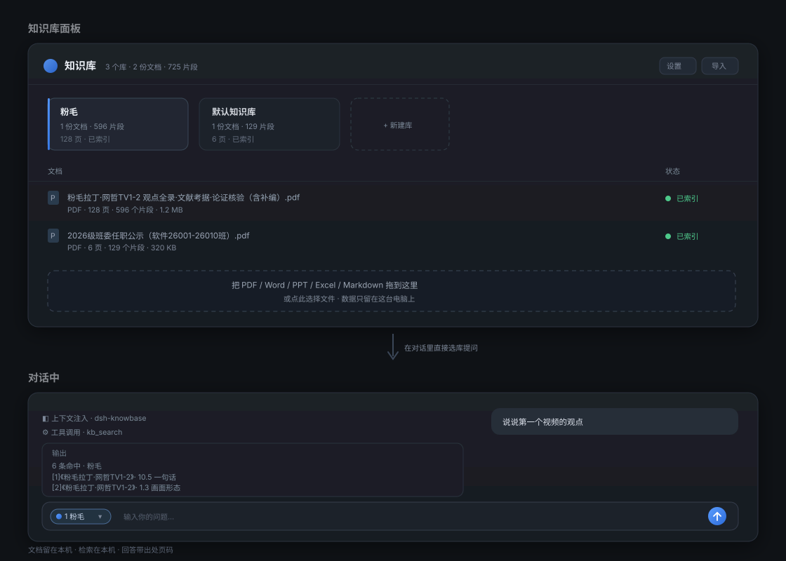

# dsh-knowbase

DeepSeek Harness 的本地知识库插件。文档导入、语义检索、权威来源采集，数据全部留在本机。

> **状态**：v0.6.8，六个开发阶段均已完成，功能可用。

<p align="center">
  
</p>

## 目录结构

```
dsh-knowbase/
├── package.json        插件清单（bundle patch + client 声明）
├── cordis.patch.yml    插入 Host 插件行
├── index.js            Host 半：知识库服务、状态接口、抓取、OCR、长任务
├── client.js           Client 半：侧栏图标、主面板、对话选库、回合摘要
├── lib/                业务模块（存储、抽取、切块、检索、模型、抓取策略……）
├── locale/
│   ├── zh.json         中文界面文案与插件元信息
│   └── en.json         英文
└── icon.svg            插件图标
```

## 界面位置

- **左侧栏图标**：位于「日程」与「上下文」之间
- **主面板**：点击图标后居中显示，与 DSH 主题一致，深浅色自动适配
- **对话输入框上方**：`@kb:库名` 标记与选库选择条，提问时自动检索

## 功能状态

| 阶段 | 内容 | 状态 |
|---|---|---|
| P0 | 插件骨架、图标、双语、界面框架 | ✅ 已完成 |
| P1 | 导入与存储：拖拽、格式解析、切块、数据库 | ✅ 已完成 |
| P2 | 检索：关键词 + 向量 + 融合 + 智能体工具 | ✅ 已完成 |
| P3 | 模型接入：本地模型、重排、OCR、参数面板 | ✅ 已完成 |
| P4 | 权威来源采集：来源清单、抓取开关、许可记录 | ✅ 已完成 |
| P5 | 界面打磨：切块修复、i18n、界面重构、详情页配图 | ✅ 已完成 |
| P6 | 收尾：安全加固、磁盘探测、版本适配、发布 | ✅ 已完成 |

## 技术要点

- **样式**：只用主题变量 `--dsw-alias-*`，不引入任何 UI 库
- **动效**：CSS 实现，遵守 `prefers-reduced-motion`
- **数据目录**：默认 `$DSH_HOME/knowbase`，可用配置项 `dataRoot` 覆盖
- **接口**：通过 `ctx.connection.fetch.register` 注册，路径 `/api/dsh-knowbase/*`
- **安全**：抓取默认关闭；内网拦截含 DNS 解析与逐跳重定向校验；API Key 走凭据库

## 自测

```bash
node scripts/selftest.mjs
```

## 许可

[MIT](../LICENSE)
